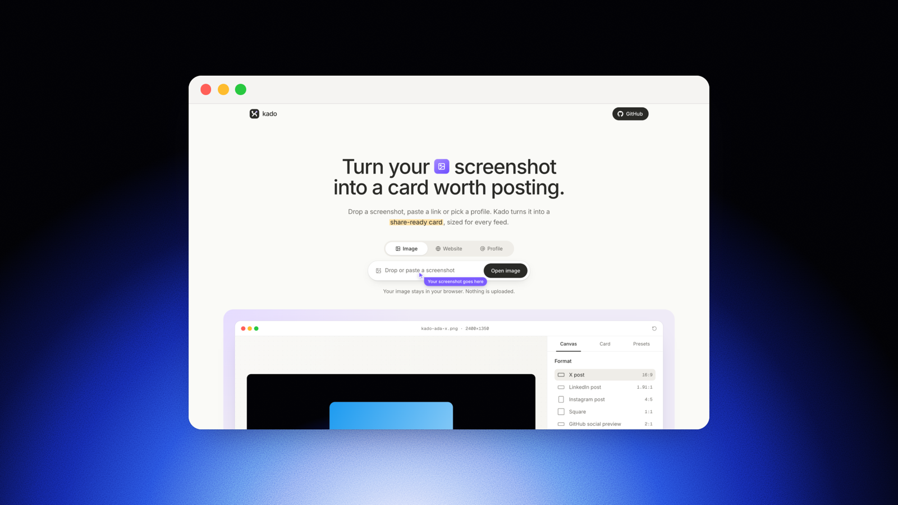
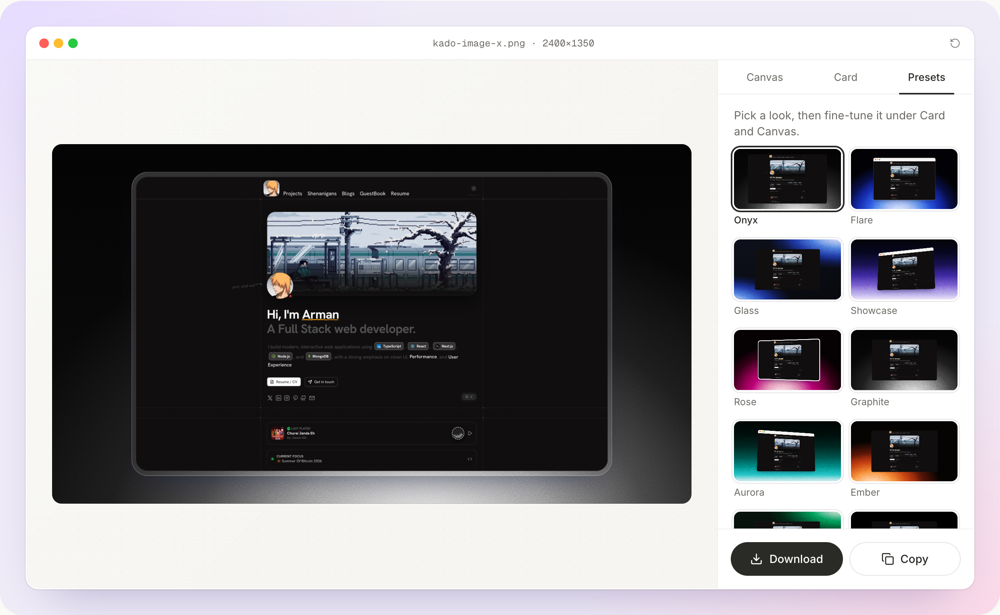
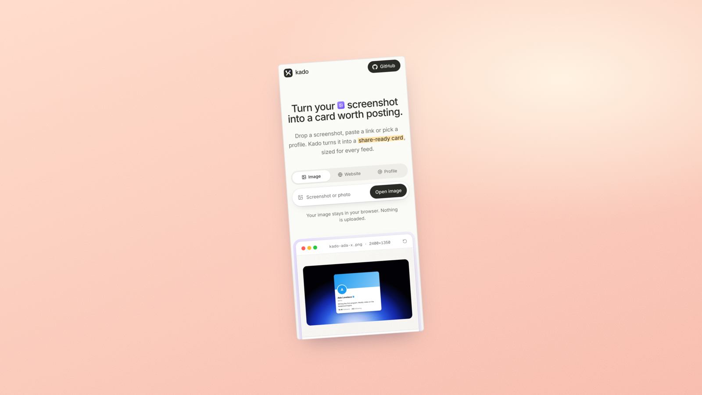
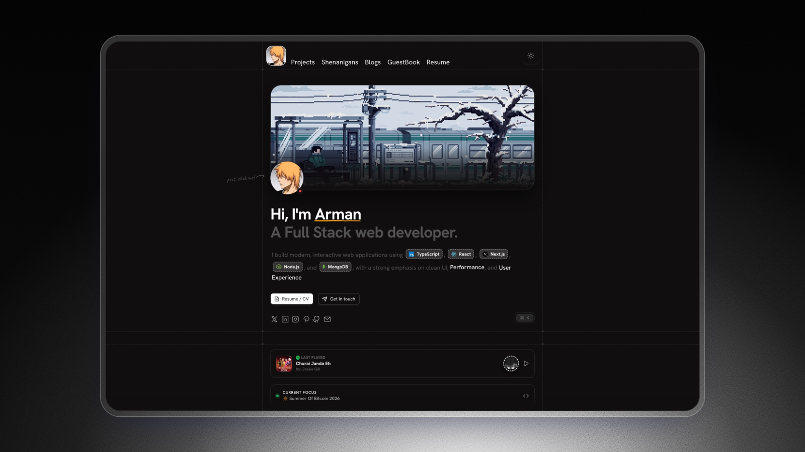
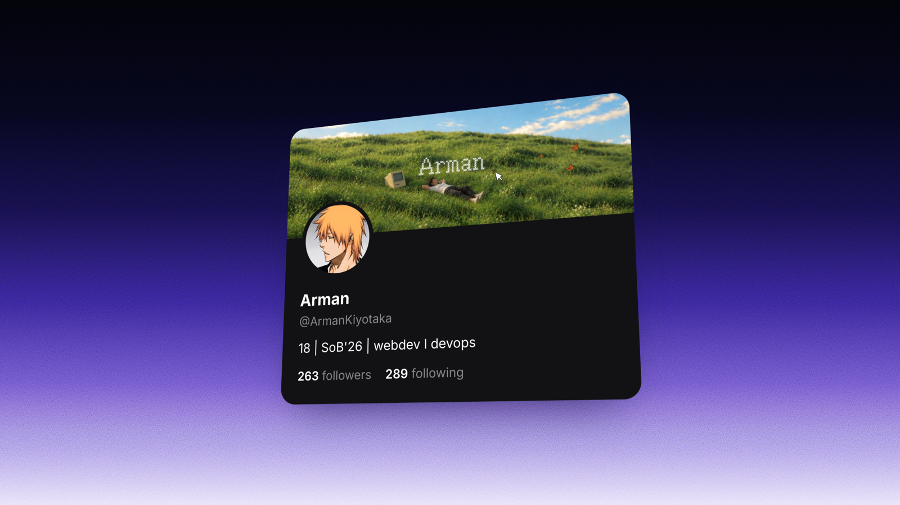

<p align="center">
  
</p>

<p align="center">
  Turn any screenshot, website or social profile into a card worth posting.<br>
  No sign-up, no design tool, nothing stored.
</p>

<h4 align="center">
  <a href="#getting-started">Getting started</a> |
  <a href="#usage">Usage</a> |
  <a href="#how-it-works">How it works</a> |
  <a href="#roadmap">Roadmap</a>
</h4>

<p align="center">
  
  
  
  
  <a href="LICENSE"></a>
  
</p>

kado turns a screenshot, a website or a social profile into a clean, share-ready image. Drop or paste an image, paste a link for kado to capture, or type an X, GitHub, YouTube or Instagram handle. Pick a preset, or tune the background, frame, shadow and tilt yourself, and kado sizes it for the feed you're posting to. Download it as a PNG or copy it straight to the clipboard.

<p align="center">
  
</p>

## Highlights

| | |
|---|---|
| Sources | Any screenshot or image, dropped, pasted or opened; any website, captured from a link at 1440 × 900; X, GitHub, YouTube and Instagram profiles pulled automatically |
| Card styles | Profiles in Native, Minimal or Ticket; images in Card, Window or Plain; each in light or dark |
| Presets | 17 finished looks, each previewed live with your own card |
| Export sizes | X post 16:9, LinkedIn 1.91:1, Instagram 4:5, Square 1:1, GitHub social preview 2:1 |
| Resolution | Every export at 2×, for example 2400 × 1350 for an X post |
| Backgrounds | Five grainy gradients, plain black, six soft tones, or your own image |
| Accounts | None. Nothing is saved on a server |

## What you can make

<table>
  <tr>
    <td width="33%"></td>
    <td width="33%"></td>
    <td width="33%"></td>
  </tr>
  <tr>
    <td align="center"><b>Screenshot</b><br><sub>Drop, paste or open any image</sub></td>
    <td align="center"><b>Website</b><br><sub>Paste a link and kado captures the page</sub></td>
    <td align="center"><b>Profile</b><br><sub>Pulled live from an X, GitHub, YouTube or Instagram handle</sub></td>
  </tr>
</table>

## Getting started

kado needs Node.js 20 or newer and [pnpm](https://pnpm.io).

```sh
git clone https://github.com/kaihere14/Kado && cd Kado
pnpm install
pnpm dev
```

Open [localhost:3000](http://localhost:3000). No keys are required.

The Website tab needs the capture server in [`capture-server/`](capture-server). Start it with `npm install && npm run dev` in that folder, then add its address to `.env.local`:

```sh
NEXT_PUBLIC_CAPTURE_URL=http://localhost:10000
```

GitHub allows 60 unauthenticated requests an hour. To raise that to 5,000, add a personal access token with no scopes to `.env.local`:

```sh
GITHUB_TOKEN=github_pat_...
```

To build for production, run `pnpm build` and then `pnpm start`. kado runs on any host that supports Next.js, including Vercel.

## Usage

1. Pick **Image**, **Website** or **Profile**. Drop, paste or open an image; paste a link; or choose a platform from the menu and type a handle. Full profile URLs and a leading `@` work too.
2. Under **Presets**, pick a finished look. Or set the **format** and **background** under **Canvas**, and the style, size, frame, shadow and tilt under **Card**.
3. For a profile, the bottom of **Card** has **Show**, to choose which numbers appear and whether to include the verified badge, banner and platform logo, and **Edit details**, to change anything the platform returned or upload your own photo and banner.
4. **Download** saves a PNG. **Copy** puts the image on your clipboard, ready to paste into a post.

## How it works

| Platform | Source | What comes through |
|---|---|---|
| X | [FxTwitter](https://github.com/FxEmbed/FxEmbed) public API | Name, bio, photo, banner, followers, following, posts, verified |
| GitHub | [GitHub REST API](https://docs.github.com/rest/users) | Name, bio, photo, followers, following, public repos |
| Instagram | Public profile page metadata, with the profile embed as fallback | Name, photo, followers, following, posts (rounded, as Instagram shows them). The fallback has exact counts and the verified badge but no following count |
| YouTube | Public channel About page | Name, description, photo, banner, subscribers (rounded, as YouTube shows them), videos, total views, verified |

Profile requests go through Next.js route handlers and are cached for an hour. Photos and banners load through a same-origin image proxy, which only accepts the X, GitHub, YouTube and Instagram image CDNs. That lets the browser draw them into the exported PNG.

Website captures come from a small Express server in `capture-server/`, which the browser calls directly. It opens the page in headless Chrome through [capture-website](https://github.com/sindresorhus/capture-website), in a 1440 × 900 window at 2×, and returns a JPEG. It refuses local and private network addresses, and limits how many captures a visitor can make.

The card is rendered at the full size of the chosen format and scaled down to fit the preview, so the download matches the preview exactly. [html-to-image](https://github.com/bubkoo/html-to-image) turns it into a PNG in your browser.

For a detailed breakdown of the architecture, implementation, trade-offs, and fixed bugs, see [docs/about.md](docs/about.md).
## Privacy

kado has no accounts or database. Vercel Web Analytics is used for page views. A handle is sent only to fetch that profile, and a website link only to capture that page; the result lives in your browser tab. Images you drop or paste, and uploaded photos and backgrounds, never leave your device.
## Roadmap

- [x] X, GitHub, YouTube and Instagram profiles
- [x] Screenshots and website captures
- [x] Presets
- [x] Feed-sized exports at 2×
- [ ] Shareable links such as `/x/handle` that open straight into the studio
- [ ] More card styles
- [ ] A dark theme for the site itself

Ideas are welcome in [issues](https://github.com/kaihere14/Kado/issues).

## Contributing

Contributions are welcome. Fork the repository, create a branch, and open a pull request. Run `pnpm lint` and `pnpm exec tsc --noEmit` before submitting.

## Built with

- [Next.js 16](https://nextjs.org) and React 19
- [Tailwind CSS 4](https://tailwindcss.com)
- [html-to-image](https://github.com/bubkoo/html-to-image) for the PNG export
- [capture-website](https://github.com/sindresorhus/capture-website) for website captures
- [Inter](https://rsms.me/inter/) and [Geist Mono](https://vercel.com/font)
- [Lucide](https://lucide.dev) icons

## About the name

Kado comes from カード (kādo), Japanese for "card". The logo puts the four platforms on one: an X whose second stroke curves like a git branch, LinkedIn's dot and Instagram's lens, all inside a rounded card.

## Star history

<a href="https://star-history.com/#kaihere14/Kado&Date">
  <picture>
    <source media="(prefers-color-scheme: dark)" srcset="https://api.star-history.com/svg?repos=kaihere14/Kado&type=Date&theme=dark" />
    <source media="(prefers-color-scheme: light)" srcset="https://api.star-history.com/svg?repos=kaihere14/Kado&type=Date" />
    
  </picture>
</a>

## License

kado is licensed under the [MIT License](LICENSE).

<p align="center">
  <sub>Made by <a href="https://x.com/ArmanKiyotaka">@ArmanKiyotaka</a></sub>
</p>
