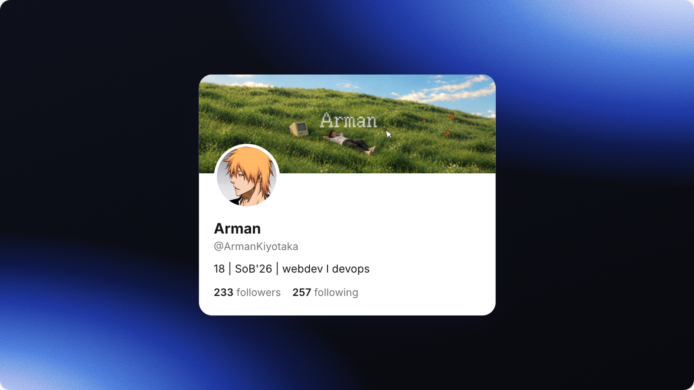
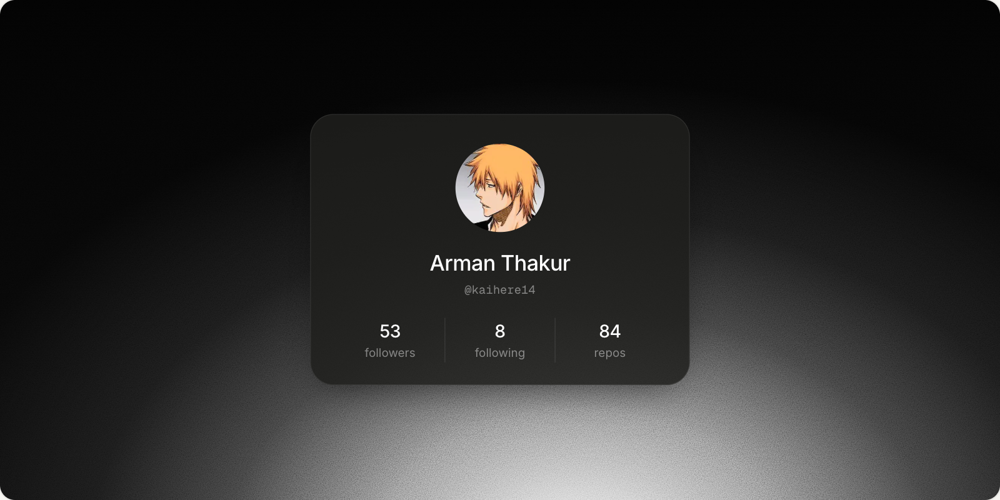
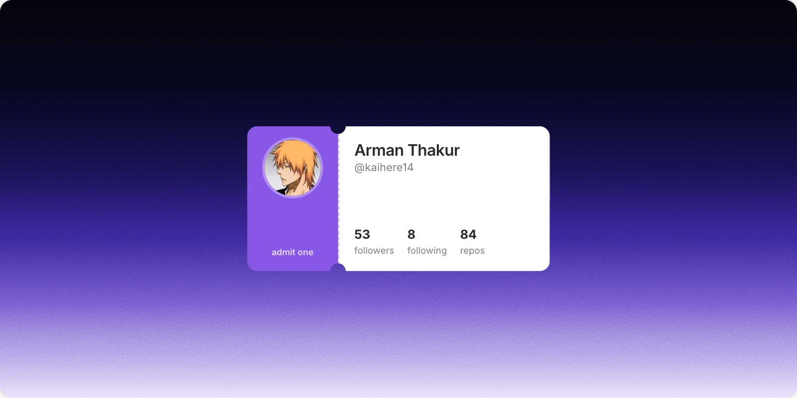

<p align="center">
  
</p>

<p align="center">
  How kado works on the inside: the decisions behind it, how each step is built,<br>
  and the bugs we ran into along the way.
</p>

<h4 align="center">
  <a href="#overview">Overview</a> |
  <a href="#architecture-decisions">Decisions</a> |
  <a href="#how-it-works-step-by-step">How it works</a> |
  <a href="#bugs-we-found-and-fixed">Bugs and fixes</a> |
  <a href="#known-limits">Known limits</a>
</h4>

## Overview

kado turns a social handle into an image you can post. You type `@ArmanKiyotaka`, it fetches the public profile, lays it out as a card in the style of that platform, places the card on a background sized for the feed, and saves it as a PNG.

There are three moving parts:

1. **The server** fetches profile data and proxies images. It has no database and no API keys (one optional token for GitHub).
2. **The studio** is a single React component that holds every setting and shows a live preview.
3. **The export** turns the preview into a PNG in the browser using [html-to-image](https://github.com/bubkoo/html-to-image).

<p align="center">
  
</p>

| | |
|---|---|
| Framework | Next.js 16 (App Router), React 19, TypeScript 5 |
| Styling | Tailwind CSS 4, with a few hand-written rules in `globals.css` |
| Image export | html-to-image, in the browser |
| Data | Public profile sources, fetched by Next.js route handlers |
| Storage | `localStorage` only. No accounts, no database |
| Hosting | Vercel, with Vercel Web Analytics for page views |

## Project map

```
src/
  app/
    page.tsx                         Landing page: header, studio, platform notes, footer
    layout.tsx                       Fonts (Inter, Geist Mono) and analytics
    globals.css                      Theme colours, easing curves, animations, export rules
    api/
      profile/[platform]/[handle]/   GET a profile as JSON
      image/                         Same-origin image proxy
  components/
    studio.tsx                       All studio state, preview scaling, export
    profile-card.tsx                 The three card styles: Native, Minimal, Ticket
    brand-icons.tsx                  Platform logos and the verified badge
    reveal.tsx                       Fade-in on scroll
    kado-logo.tsx                    The logo
  lib/
    platforms.ts                     Platform list, the Profile type, handle parsing, number formatting
    fetchers.ts                      One fetcher per platform (server only)
    formats.ts                       Export sizes and the 2x scale
    backdrops.ts                     Background gradients, film grain and background adjustments
    color.ts                         Hex <-> OKLCH, for turning a gradient's hue
    warp.ts                          Projects a flat render of a tilted card onto the export
    saved-studio.ts                  Save and restore the studio in localStorage
```

## Architecture decisions

Each decision below lists what we chose, why, and what it costs us.

### 1. Make the PNG in the browser, not on a server

**Decision:** The card is ordinary HTML and CSS. When you press Download, html-to-image copies that HTML into an SVG, draws the SVG on a `<canvas>`, and saves the canvas as a PNG.

**Why:**

- **The preview is the export.** There is one card component. Whatever you see is what you get, down to the pixel.
- **The cards use rich CSS:** masks for the ticket notches, `backdrop-filter`, stacked gradients, blend modes for grain. Server renderers such as `next/og` (Satori) support only a subset of CSS and would need a second copy of every card.
- **Privacy.** Uploaded photos and backgrounds never leave the device.
- **Cost.** No headless browser to run, no render queue.

**Trade-off:** The result depends on the browser engine drawing it. Safari, and every browser on iOS (they all use Safari's engine, WebKit), behaves differently from Chrome. Most of the bugs further down come from this. We kept the approach and added iOS-specific handling instead of switching renderers.

### 2. Render the card at full size and shrink the preview

**Decision:** The frame is always rendered at its real export size, for example 1200 × 675 for an X post. The preview shrinks it with a CSS `transform: scale(...)` to fit the screen.

**Why:** If the card were laid out at preview size and scaled up for export, text wrapping and line breaks could differ between the two. Laying out once at the real size means the export matches the preview exactly.

```ts
// studio.tsx: fit the full-size frame into the preview area, whichever side is tighter
const previewScale = Math.min(previewBox.width / format.width, previewBox.height / format.height);
```

A `ResizeObserver` on the preview area updates `previewBox` whenever the layout changes.

### 3. Fetch profiles on the server, through our own route

**Decision:** The browser calls `/api/profile/<platform>/<handle>`. The route handler fetches the data from the platform and returns a single, consistent `Profile` shape.

**Why:**

- Most sources block browser requests (CORS), and some need server-only tricks, such as a specific `User-Agent` or a cookie.
- One shape for every platform keeps the card components simple.
- Responses are cached on the CDN for an hour (`s-maxage=3600, stale-while-revalidate=86400`), so a popular handle isn't fetched again for every visitor.

### 4. Proxy images through our own domain

**Decision:** Avatars and banners load from `/api/image?url=<original url>` instead of straight from the platform's CDN.

**Why:** A canvas that draws an image from another domain becomes "tainted", and the browser then refuses to export it. Serving every image from our own origin avoids that.

To keep the proxy from being used to fetch arbitrary URLs, it:

- only accepts `https` URLs on known image hosts (`pbs.twimg.com`, `avatars.githubusercontent.com`, `yt3.googleusercontent.com`, Instagram's `*.cdninstagram.com` and `*.fbcdn.net`, and a few others),
- only returns responses whose type starts with `image/`,
- refuses anything over 8 MB,
- caches results for a day in the browser and a week on the CDN.

### 5. No accounts, no database

**Decision:** Nothing is stored on a server. The studio saves your last session in `localStorage` so a refresh doesn't lose your work.

**Why:** kado is a one-shot tool. Not having accounts removes sign-up friction, a whole category of privacy questions, and a database to run.

### 6. One config object per platform drives the UI

**Decision:** Everything that differs between platforms lives in one table, `PLATFORMS` in `platforms.ts`: the label, the URL prefix, which stats exist, which are shown by default, whether there's a banner, and whether data can be fetched automatically.

**Why:** Adding a platform means adding one entry and one fetcher. The studio and the cards read from the config, so they don't need to change.

```ts
youtube: {
  label: "YouTube",
  prefix: "youtube.com/@",
  fetchable: true,
  stats: [{ key: "subscribers", ... }, { key: "videos", ... }, { key: "views", ... }],
  defaultVisible: ["subscribers", "videos"],
  hasBanner: true,
},
```

### 7. Every card scales from one number

**Decision:** A card is designed at 360 px wide. Its real width comes from the chosen size and format, and everything inside is sized in `em` from a base font of `14px × scale`, where `scale = width / 360`.

**Why:** Changing size (S, M, L) or format only changes one number. Spacing, avatar size, borders and text all follow, so the card looks the same at every size.

### 8. Handle iPhone quirks on iPhone only

**Decision:** Exports on iPhone and iPad turn off the card's shadow and render 5 times. Every other device renders once, with the shadow.

**Why:** These are WebKit workarounds, and they make exports slower. Applying them only where they're needed keeps desktop and Android fast. See [bugs 7 and 12](#bugs-we-found-and-fixed).

## How it works, step by step

### Step 1: Read the handle

People paste handles in many forms. `normalizeHandle` in `platforms.ts` reduces them all to the bare handle:

| You type | kado uses |
|---|---|
| `@ada` | `ada` |
| `https://www.x.com/ada?s=20` | `ada` |
| `github.com/octocat/` | `octocat` |
| `youtube.com/@mkbhd` | `mkbhd` |
| `linkedin.com/in/your-name` | `your-name` |

It strips the protocol and `www.`, then the platform's domain, cuts everything after the first `/`, `?` or `#`, and drops a leading `@`.

### Step 2: Fetch the profile

The studio calls `/api/profile/<platform>/<handle>`. The route handler:

1. checks that the platform exists,
2. checks the handle against `^[A-Za-z0-9_.-]{1,64}$`,
3. calls the fetcher for that platform,
4. returns the profile as JSON, or `{ error }` with a status code.

Each fetcher in `fetchers.ts` returns the same shape:

```ts
interface Profile {
  platform: "x" | "github" | "linkedin" | "instagram" | "youtube";
  handle: string;
  name: string;
  bio: string;
  avatarUrl: string | null;
  bannerUrl: string | null;
  verified: boolean;
  url: string;
  stats: { key: string; label: string; value: number }[];
}
```

| Platform | Source | How it's read |
|---|---|---|
| X | [FxTwitter](https://github.com/FxEmbed/FxEmbed) public API | A JSON request with a `User-Agent` (FxTwitter rejects requests without one). An unknown handle comes back as an HTML redirect, so a non-JSON response counts as "not found". The avatar URL is upgraded from `_normal` to `_400x400`, and the banner to `/1500x500`, so they stay sharp at 2×. |
| GitHub | GitHub REST API | `api.github.com/users/<handle>`. An optional `GITHUB_TOKEN` raises the limit from 60 to 5,000 requests an hour. A 403 means the rate limit was hit and is reported as such. |
| Instagram | Public profile page, then the profile embed | Instagram shows a login wall to anonymous visitors from data centres, but still serves preview tags to Meta's own link crawler. So we ask with that crawler's `User-Agent` and read `og:description`: `"1.2M Followers, 512 Following, 340 Posts"`. If that fails, we read the embed widget, whose data is JSON stored as a string inside other JSON (so it's parsed twice). |
| YouTube | The channel's About page | The page embeds all its data in `ytInitialData`. `?hl=en` keeps the counts in English, and a `SOCS` cookie skips the cookie consent page shown in the EU. YouTube moves things around, so `findKey` searches the whole object for the field it needs instead of following a fixed path. |
| LinkedIn | You | LinkedIn blocks profile access, so the studio gives you a blank card to fill in. |

Counts written in short form are turned back into numbers by `parseCount`: `"687M"` becomes `687000000`, `"8,612"` becomes `8612`.

### Step 3: Show it in the studio

`showProfile` in `studio.tsx` puts the profile on the card and resets the options to that platform's defaults, keeping the card style you picked. For example, a YouTube profile switches the format to "X post" (16:9) and shows subscribers and videos.

If an Instagram profile can't be read (private accounts, for example), you still get a blank Instagram card to fill in, with a message explaining why.

A `generation` counter goes up each time a new profile arrives. It's used as the card's React `key`, so only freshly fetched cards play the entrance animation, and as the trigger to scroll the studio into view.

### Step 4: Draw the card

`ProfileCard` picks one of three components:

<table>
  <tr>
    <td width="33%"></td>
    <td width="33%"></td>
    <td width="33%"></td>
  </tr>
  <tr>
    <td align="center"><b>Native</b><br><sub>The platform's own header: banner, avatar overlapping it, stats</sub></td>
    <td align="center"><b>Minimal</b><br><sub>Frosted glass, using a translucent fill and <code>backdrop-filter</code></sub></td>
    <td align="center"><b>Ticket</b><br><sub>Two half-circle notches cut with a CSS <code>mask</code></sub></td>
  </tr>
</table>

**Card width** is a share of the frame, capped by the frame's height so wide formats never overflow:

| Size | Share of frame width | Share of frame height (cap) |
|---|---|---|
| S | 40% | 62% |
| M | 50% | 76% |
| L | 60% | 90% |

Example: size M on an X post (1200 × 675) gives `min(1200 × 0.5, 675 × 0.76)`, which is 513 px.

Other details:

- **Rectangle shape** caps the card's height at 0.74 × its width. It's a maximum, not a fixed height, so a profile with no bio doesn't leave an empty block.
- **Missing avatar:** the card shows the first letter of the name on the platform's colour.
- **Numbers** under 10,000 are written in full (`8,612`); larger ones are shortened (`18.4K`).
- **Images** go through `proxied()`, which rewrites remote URLs to `/api/image?url=...`. Uploaded images (`data:` URLs) are left as they are.

**Frame, shadow and tilt** (`CardEffects`) sit around the card rather than inside it, so they stay put when a new profile loads:

| Setting | How it's drawn |
|---|---|
| Frame | A wrapper with padding: **Glass** (translucent white), **Solid** (an off-white or dark mat) or **Line** (a stroke only). Its radius is the card's radius plus the gap, so the corners stay concentric. Glass and Line switch to darker tones on light backgrounds. |
| Shadow | 0–100, where 50 is each card's original shadow. With a Glass or Solid frame, the frame carries the shadow and the card keeps a faint one. The Ticket's notch mask would clip a `box-shadow`, so it gets a `drop-shadow()` filter instead. |
| Rotate | `rotate()`, flat on the page. |
| Tilt X / Tilt Y | `perspective(2.5 × card width) rotateX() rotateY()` on the wrapper marked `data-card-tilt`. |

### Step 5: Lay out the frame and background

The frame is a `<div>` exactly the size of the export format:

| Format | Ratio | Size | Exported at 2× |
|---|---|---|---|
| X post | 16:9 | 1200 × 675 | 2400 × 1350 |
| LinkedIn post | 1.91:1 | 1200 × 627 | 2400 × 1254 |
| Instagram post | 4:5 | 1080 × 1350 | 2160 × 2700 |
| Square | 1:1 | 1080 × 1080 | 2160 × 2160 |
| GitHub social preview | 2:1 | 1280 × 640 | 2560 × 1280 |

Backgrounds in `backdrops.ts` are plain CSS `background` strings. The dark gradients add **film grain**: a small SVG of random noise (`feTurbulence`), tiled every 220 px and blended with `overlay` on top of the gradient only:

```ts
background: `${grainLayer(0.5)}, radial-gradient(...), #020205`,
backgroundBlendMode: "overlay, normal, normal",
```

An uploaded background is a `data:` URL shown with `center / cover`.

**Background adjustments** (`BackdropTune`) are applied by `tunedBackdrop` when the frame renders. Picking a new background resets them to that background's defaults.

| Setting | Gradient backgrounds | Uploaded image |
|---|---|---|
| Hue | Every hex colour turns by the same angle in OKLCH, which keeps lightness steady. Colours pushed out of sRGB give up chroma until they fit. | Not available |
| Intensity | Every colour stop's position is multiplied by up to 1.64× (or down to 0.61×), so the light reaches further or shrinks. Sizes and positions, which also end in `%`, are left alone. | `brightness()` |
| Blur | CSS `blur()` on the background layer, which bleeds three radii past the frame so the edges don't fade. | Blurred in script, see [bug 13](#bugs-we-found-and-fixed) |
| Grain | The same noise tile on its own layer, blended with `mix-blend-mode: overlay`, so blurring the background doesn't smear it. | Same |

A slider that can't change the current background (Hue on Graphite, Blur on Black) is disabled rather than hidden, so the panel never changes height.

### Step 6: Export the image

Both buttons call `exportImage` in `studio.tsx`.

```
Download or Copy pressed
  └─ already exporting? → ignore the tap, the spinner keeps going
  └─ renderFrame(node)
       ├─ iOS: add data-flat-export, which removes the card's shadow
       ├─ card not rotated or tilted?
       │    └─ toCanvas(node), at 2×   (iOS: 5 times, keep the last)
       ├─ otherwise
       │    ├─ toCanvas(node) without the card          → the background
       │    ├─ toCanvas(card) flat, padded, at 3×       → the card and its shadow
       │    └─ drawProjected: warp the card through its CSS transform onto the background
       └─ remove data-flat-export
  └─ canvas → PNG Blob
  └─ Download → blob: URL → <a download="kado-<handle>-<format>.png">
     Copy     → navigator.clipboard.write(ClipboardItem)
                  └─ fails? → download instead
```

The options passed to html-to-image:

```ts
{
  pixelRatio: 2,              // 2x output
  cacheBust: true,            // don't reuse a stale image from the browser cache
  includeQueryParams: true,   // see bug 9
  width: format.width,
  height: format.height,
}
```

Important details:

- **Tilted cards are projected in script.** WebKit draws transforms inside the exported SVG without perspective, so a 3D tilt comes out as a flat squash, and it smears the shadows of rotated elements. `warp.ts` reads the card's computed `transform` and `transform-origin`, builds the 3×3 projective matrix from flat-render pixels to export pixels, and, for every export pixel in the card's bounding box, maps back to the flat render and takes four bilinear samples. Sampling uses premultiplied alpha, so the card's edges and shadow don't pick up dark fringes. Every browser takes this path, so what's tested in Chrome is what Safari gets.
- **Copy passes a promise, not an image.** `new ClipboardItem({ "image/png": renderPromise })`. Safari only allows copying straight after a tap, and rendering takes longer than that. Handing over a promise lets Safari wait for it.
- **Downloads use a `blob:` URL**, not a `data:` URL, and each one is kept until the next download replaces it. See [bug 8](#bugs-we-found-and-fixed).
- **One export at a time.** `exportingRef` is set when an export starts and cleared when it ends, whether it succeeded or failed. Taps in between are ignored.
- The buttons show "Downloaded" or "Copied" for 1.8 seconds, then reset.

### Step 7: Remember the session

`saved-studio.ts` saves the platform, input, profile, options, background, background adjustments, card effects and format under the key `kado:studio:v1`.

- It saves 300 ms after you stop editing, and again on `pagehide`, so a refresh mid-typing keeps the last keystroke.
- It restores **after** the page has loaded in the browser, not during server rendering. The server can't read `localStorage`, and restoring earlier would make the server HTML and the browser HTML disagree (a hydration mismatch).
- Preset backgrounds are saved by id, so if a gradient is tweaked later, old sessions get the new look.
- If uploaded images push it past the browser's storage limit (about 5 MB), it saves again without the uploads, so at least your typed details survive.
- The `v1` in the key gets bumped whenever the saved shape changes, so an old save is dropped instead of misread. New fields with a default don't need a bump: `withDefaults` fills in anything a save from before the field existed is missing.

## Bugs we found and fixed

Each one lists what people saw, what caused it, and what changed.

### 1. Exports lost their grain and came out darker

**Seen:** The preview had fine grain; the downloaded PNG was smooth, darker and more saturated.

**Cause:** The grain SVG uses `filter='url(#n)'`. html-to-image scans background CSS for `url(...)`, treated `#n` as a file to fetch, failed, and blanked the reference. The SVG then drew a solid black rectangle, blended over the gradient.

**Fix:** The parentheses in the SVG are percent-encoded (`%28`, `%29`). html-to-image no longer recognises it as a `url(...)`, and the browser still decodes it, so the preview is unchanged.

### 2. Rectangle cards had an empty block at the bottom

**Seen:** GitHub and Instagram cards, which usually have no bio or banner, had a large blank space at the bottom.

**Cause:** Rectangle cards had a fixed height of 0.74 × their width.

**Fix:** 0.74 became a `maxHeight`. Short cards fit their content; long ones are still capped.

### 3. Instagram profiles failed to load in production

**Seen:** Instagram returned its login page instead of profile data, including on Vercel.

**Cause:** Instagram shows a login page to anonymous requests from data-centre IP addresses.

**Fix:** Request the page as Meta's link-preview crawler, which still gets the preview tags. If that fails, fall back to the profile embed widget, which has exact counts and the verified badge but no following count.

### 4. YouTube responses couldn't be cached

**Seen:** Next.js couldn't cache the YouTube page it fetched, so caching it had no effect.

**Cause:** The About page is about 3 MB, over the 2 MB limit for Next.js's fetch cache.

**Fix:** The fetch uses `cache: "no-store"`, and the route's own `Cache-Control` header caches the small JSON result on the CDN instead.

### 5. The phone layout was hard to use

**Seen:** On phones, inputs zoomed the page when tapped, swipes got stuck inside the settings panel, platform tabs wrapped onto two lines, and scroll animations stuttered.

**Fixes:**

- Inputs use a 16 px font on phones. iOS zooms into any input with a smaller font.
- The settings panel scrolls on its own only on desktop. On phones, an empty scroll box with `overscroll-contain` swallowed page swipes.
- The preview sticks to the top of the screen on phones, so every tweak stays in view, and the export buttons stick to the bottom, above the home indicator (`env(safe-area-inset-bottom)`).
- Platform tabs sit in a fixed grid on phones so they never wrap.
- The scroll-in animation skips the blur on phones, because blur is expensive to animate on large sections.

### 6. The sticky preview slid under the settings

**Seen:** On phones, settings controls scrolled over the top of the sticky preview.

**Fix:** The preview's stacking order was raised (`z-10` to `z-20`).

### 7. A hard grey block next to the card on iPhone

**Seen:** iPhone exports had a solid grey-purple rectangle along one edge of the card.

```
Before (iPhone)                    After (iPhone)
┌──────────────┐▓▓                 ┌──────────────┐
│  card        │▓▓                 │  card        │
│              │▓▓                 │              │
└──────────────┘▓▓                 └──────────────┘
```

**Cause:** The card's shadow is soft and blurred: `0 18px 40px -18px rgba(22,22,63,.45)`. When WebKit draws it inside the SVG, it skips the blur and shifts it, which leaves a solid strip of exactly the shadow's colour.

**Fix:** On iOS only, the export turns the shadow off.

- The Native and Minimal cards carry a `data-card-shadow` attribute.
- While an iOS export renders, the frame gets a `data-flat-export` attribute, and this rule removes the shadow:

```css
[data-flat-export] [data-card-shadow] {
  box-shadow: none !important;
}
```

html-to-image copies the styles the page has **at that moment**, so the change has to be made on the live page. On iPhone, the preview's shadow disappears for the second or two the export takes. Other devices keep the shadow in their exports.

### 8. Download did nothing on iPhone

**Seen:** Safari showed its "Download / View" prompt, but tapping Download saved nothing.

**Cause:** The image was passed as a `data:` URL, which is the whole PNG written out as text, several megabytes long:

```
data:image/png;base64,iVBORw0KGgoAAAANSUhEUgAACWAAAAVG...   (megabytes of this)
```

iOS's download handling gives up on a link that size, silently.

**Fix:** The PNG is kept as a `Blob` and linked with a short `blob:` URL:

```
blob:https://kado.armandev.space/3f2a9c1e-...
```

Safari only fetches the link after you tap Download in its prompt, which can be seconds later. So the URL isn't freed straight away; it's kept until the next download replaces it.

### 9. Exports could show the wrong photo

**Seen:** On any device, a YouTube card could export with the avatar in the banner slot. Or you exported one profile, loaded another, exported again, and got the first profile's photo.

**Cause:** html-to-image caches images it has fetched, keyed by URL, but by default it **removes the `?query` part** first. Every proxied image looks like `/api/image?url=...`, so they all became the same key, `/api/image`, and the first image fetched was reused for the rest.

**Fix:** `includeQueryParams: true` makes the full URL the key.

### 10. "Your browser blocked copying the image"

**Seen:** Copy always failed when testing on a phone over the local network, on every browser.

**Cause:** Browsers only provide the clipboard API on secure pages: `https://...` or `http://localhost`. On `http://192.168.x.x:3000`, `navigator.clipboard` doesn't exist. On the real https site, copying worked.

**Fix:** If copying fails for any reason, the image is downloaded instead, and the error message was removed. The only error left is when the image can't be rendered at all.

### 11. Double-tapping an export saved it twice

**Seen:** Tapping Download twice quickly started two renders and saved two files. On iPhone, the first render to finish also turned the preview's shadow back on while the second was still working.

**Fix:** One export at a time (`exportingRef`). Extra taps are ignored and the spinner keeps going until the current export is finished.

Today's html-to-image reads all the styles at the very start of a render, so the second image didn't actually get the shadow back. The guard makes sure it never depends on that.

### 12. Avatar and banner missing on iPhone

**Seen:** iPhone exports often had the name, bio and background, but empty slots where the avatar and banner should be. Trying Download or Copy 2 or 3 times eventually gave a complete image.

**Cause:** WebKit reports the SVG as ready before it has finished decoding the photos inside it, so the first draw leaves them out. Each attempt leaves the photos decoded in WebKit's cache, which is why later attempts worked. html-to-image has open issues about the same thing ([#488](https://github.com/bubkoo/html-to-image/issues/488), [#361](https://github.com/bubkoo/html-to-image/issues/361), [#420](https://github.com/bubkoo/html-to-image/issues/420)).

**Fix:** On iPhone and iPad, each export renders 5 times and keeps the last result, which does the retrying for you.

```ts
const IOS_RENDER_PASSES = 5;

let canvas = await toCanvas(node, options);
for (let i = 1; ios && i < IOS_RENDER_PASSES; i++) {
  canvas.width = canvas.height = 0; // free the discarded canvas right away
  canvas = await toCanvas(node, options);
}
```

iOS limits the total memory all canvases on a page can use, and past that new canvases come out blank. Shrinking each discarded canvas to 0 × 0 frees its memory immediately, so 5 renders don't add up. Exports on iPhone take a little longer as a result; every other device still renders once.

### 13. Blurred uploads faded at the edges on Safari

**Seen:** With a blurred uploaded background, Safari exports faded to transparent around the edges, worst in the corners. Gradients blurred fine.

**Cause:** WebKit paints only the part of a background image that falls inside the frame, then blurs it. The 3-radius bleed past the frame never gets painted, so the blur pulls in transparency.

**Fix:** Uploads are blurred in script (`blurImage`): the image is shrunk until the blur radius is about 4 px, run through three box-blur passes that repeat the edge pixels, and shown with `cover` like any upload. The preview uses a CSS blur while the slider moves and switches to the scripted one 120 ms after it stops. As a side effect, the small blurred image also decodes in time for the first Safari export.

## What we tried and dropped

| Idea | Why we dropped it |
|---|---|
| Rendering 4 times on every Safari, including macOS | We thought the extra time made macOS Safari refuse to copy. The copy failures turned out to be [bug 10](#bugs-we-found-and-fixed) (testing over plain http), but iPhone was the only place that needed the extra renders anyway. |
| A two-tap "Save image" button on iPhone | Based on the guess that Safari ignored downloads started too long after the tap. The prompt was appearing, so the tap was fine; the real cause was [bug 8](#bugs-we-found-and-fixed). |
| Rendering once, then redrawing the same image a few times, 100 ms apart | This is how [modern-screenshot](https://github.com/qq15725/modern-screenshot) handles bug 12. It's cheaper (about 0.4 s instead of 4 extra renders) but untested on a device. Rendering 5 times matched what already worked when testing by hand. It's the next thing to try if iPhone exports feel slow. |
| Switching to another library | modern-screenshot and snapdom use the same SVG technique, so the same WebKit engine draws the result, with the same quirks. |
| Rendering on the server with `next/og` | Consistent on every device, but every card would need rewriting, and it doesn't support `mask` or `backdrop-filter`. |

## Known limits

- **iPhone exports have no card shadow** and take a little longer than on other devices. The Shadow slider still changes the preview.
- **A tilted card is resampled.** It's rendered at 3× and projected down to 2×, so its text is a touch softer than on a flat card.
- **Copy needs https.** On a local network address it falls back to a download.
- **Instagram** gives no bio, and the embed fallback gives no following count. You fill those in by hand.
- **YouTube and Instagram counts are rounded**, the same way those sites show them (`21.4M`).
- **LinkedIn** is entirely manual.
- **Scraped sources can change.** The YouTube and Instagram fetchers read pages that aren't official APIs. `findKey` makes YouTube more tolerant of layout changes, but a big redesign could break either fetcher.

## Working on kado

- Run `pnpm lint` and `pnpm exec tsc --noEmit` before opening a pull request.
- **Test export changes on a real iPhone, over https.** Chrome on a desktop doesn't show WebKit's quirks, and copying only works on https (or `localhost`). A Vercel preview deployment works well for this.
- To test on a phone over your local network, add your computer's IP address to `allowedDevOrigins` in `next.config.ts`. Expect Copy to download instead.
- Set `GITHUB_TOKEN` in `.env.local` if you hit GitHub's limit of 60 requests an hour.

<p align="center">
  <sub>Back to the <a href="../README.md">README</a></sub>
</p>
